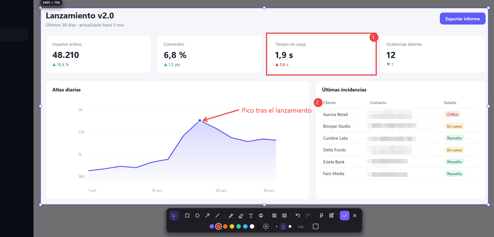

<p align="center">
  
</p>

<h1 align="center">Destello</h1>

<p align="center">
  Capturador de pantalla para Windows, rápido y sin distracciones: seleccionas un área, la anotas y la copias.<br>
  <b>Ctrl+V en una carpeta del Explorador crea el archivo PNG</b>, como en Linux.
</p>

<p align="center">
  <a href="../../releases/latest"></a>
  
  
</p>



Escrito en Rust sobre Win32, Direct2D y DirectWrite. Un único `.exe` de ~1,4 MB, sin dependencias, con instalador que no pide administrador.

## Descargar e instalar

Descarga **`Destello_X.Y.Z_x64-setup.exe`** de la [última release](../../releases/latest) y ábrelo.

Se instala solo para tu usuario, sin pedir administrador, en `%LOCALAPPDATA%\Programs\Destello`. Crea un acceso directo en el menú Inicio y, si lo dejas marcado, añade el arranque con Windows y el comando `destello` en el PATH. Se desinstala desde *Configuración → Aplicaciones instaladas*. Para actualizar, basta con instalar la versión nueva encima.

> El instalador no está firmado: la primera vez Windows SmartScreen puede avisar. Pulsa *Más información → Ejecutar de todas formas*. Cada release publica `SHA256SUMS.txt` para comprobar la descarga.

## Uso

| Atajo | Acción |
|---|---|
| `ImpPnt` | Seleccionar un área (también ventanas, menús y el menú Inicio abiertos) |
| `Ctrl+ImpPnt` | Pantalla completa del monitor del cursor |
| `Shift+ImpPnt` | Todos los monitores |
| `Ctrl+Shift+ImpPnt` | Ventana activa |
| `Ctrl+Alt+ImpPnt` | Repetir la última área |

Dentro de la selección:

- **Herramientas**: mover `V`, rectángulo `R`, elipse `E`, flecha `A`, línea `L`, lápiz `P`, marcador `M`, texto `T`, contador `N`, pixelar `B` y censurar `X`. Lo que dibujas queda recortado al área seleccionada.
- **Copiar** `Enter`: la imagen va al portapapeles como imagen *y* como archivo. Pégala en cualquier aplicación o con `Ctrl+V` en una carpeta.
- **Guardar como…** `Ctrl+S`: elige carpeta y nombre (recuerda la última carpeta).
- **Fijar** `Ctrl+P`: deja la captura flotando encima de todo.
- **Deshacer / rehacer** `Ctrl+Z` / `Ctrl+Y`. **Cerrar** `Esc`.

Destello nunca guarda nada por su cuenta: la captura solo vive en el portapapeles hasta que copias otra cosa, como cualquier texto copiado.

### Línea de comandos

```text
destello                        Arranca en la bandeja del sistema
destello gui [--delay N]        Selección de área
destello full [opciones]        Captura directa de monitor(es)
    --monitor N                 1-based; por defecto, el monitor del cursor
    --all                       Todos los monitores
    --delay N                   Segundos de espera (0-3600)
    --path RUTA                 Guarda en un archivo o carpeta
    --clipboard                 Copia además al portapapeles
destello window [--delay N]     Ventana activa
destello --version | --help
```

## Compilar desde el código

Requisitos: Windows 10/11 x64, [Rust](https://rustup.rs) estable, las *Build Tools* de Visual Studio (MSVC y Windows SDK) y, para el instalador, [Inno Setup 6](https://jrsoftware.org/isinfo.php).

```powershell
cargo test
cargo build --release
# Instalador (requiere Inno Setup 6): genera dist\Destello_1.0.0_x64-setup.exe
& "C:\Program Files (x86)\Inno Setup 6\ISCC.exe" /DAppVersion=1.0.0 installer\destello.iss
```

## CI/CD

- **Cada PR** pasa el pipeline central [`platform-pipeline`](https://github.com/carlos-anpr/platform-pipeline):
  - **Commits y criterios:** Conventional Commits, y cada criterio `AC-n` tiene su test (`fn acN_…`).
  - **Calidad:** clippy con `-D warnings`, duplicación y complejidad.
  - **Tests:** en Windows.
  - **Guardarraíles y procedencia.**
  - **Seguridad:** gitleaks, Semgrep, OSV-Scanner y zizmor.
- **Cada etiqueta `vX.Y.Z`** lanza [`release.yml`](.github/workflows/release.yml):
  1. Comprueba que la etiqueta coincide con `Cargo.toml`.
  2. Repite clippy y los tests, y compila.
  3. Genera el instalador y lo prueba (instala y desinstala en limpio).
  4. Publica la release con el instalador y `SHA256SUMS.txt`.

  Para sacar una versión: sube `version` en `Cargo.toml` en un PR y, cuando esté en `main`, ejecuta `git tag vX.Y.Z && git push origin vX.Y.Z`.
